# LLM Training & Inference Stack — 3D Visual Atlas

A collection of **15 3D diagrams** and a Jupyter notebook that visualize the key ideas behind training and serving large language models: preference optimization (DPO, RLAIF), attention kernels (FlashAttention-2, Ring, Striped, Blockwise), distributed training (FSDP, DeepSpeed, Megatron), Mixture-of-Experts, and inference engines (vLLM PagedAttention, FlashDecoding).

> **Note:** all diagrams are **illustrative concept visuals** built from synthetic or formula-based data. They show the *shape* of a trade-off, not measured benchmark results. Labels such as "24x" come from the idealised models used to draw them.

---

## 1. Alignment & Preference Optimization

| DPO Loss Landscape | DPO vs PPO Reward |
|---|---|
| 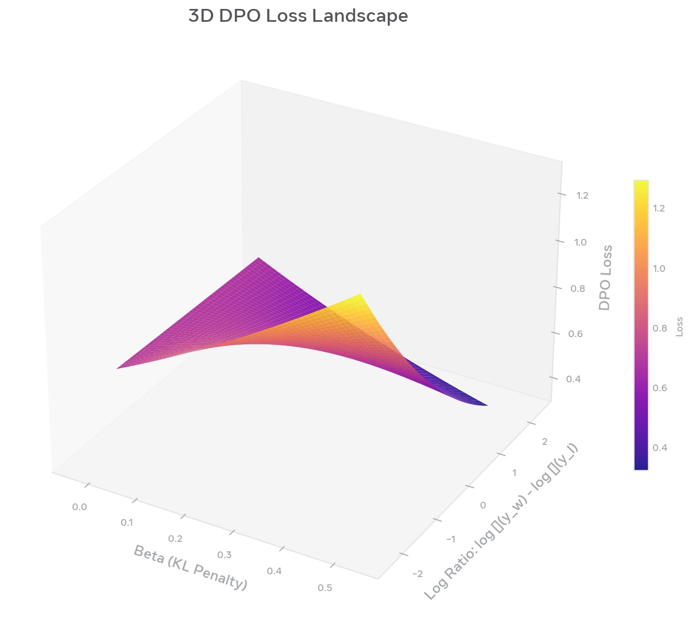 | 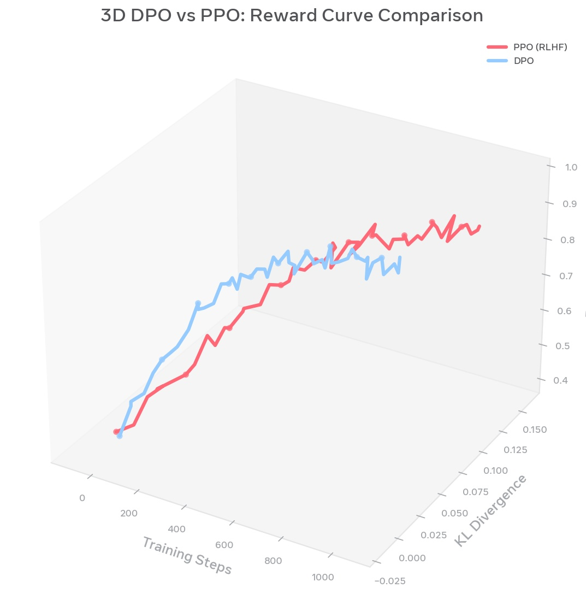 |

| Constitutional AI | RLAIF vs RLHF |
|---|---|
| 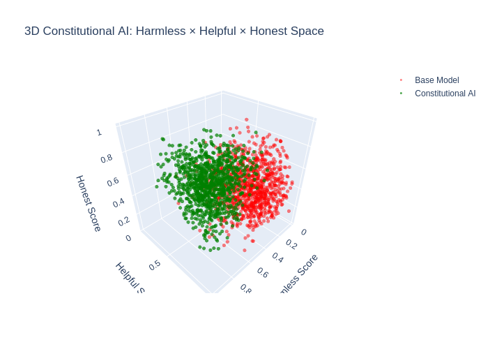 | 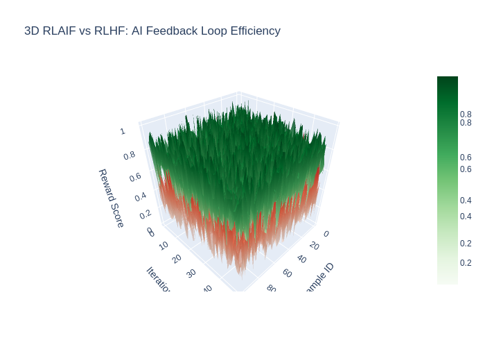 |

## 2. Attention Mechanisms

**FlashAttention-2**

| Block Tiling (causal mask) | Bandwidth vs V1 |
|---|---|
| 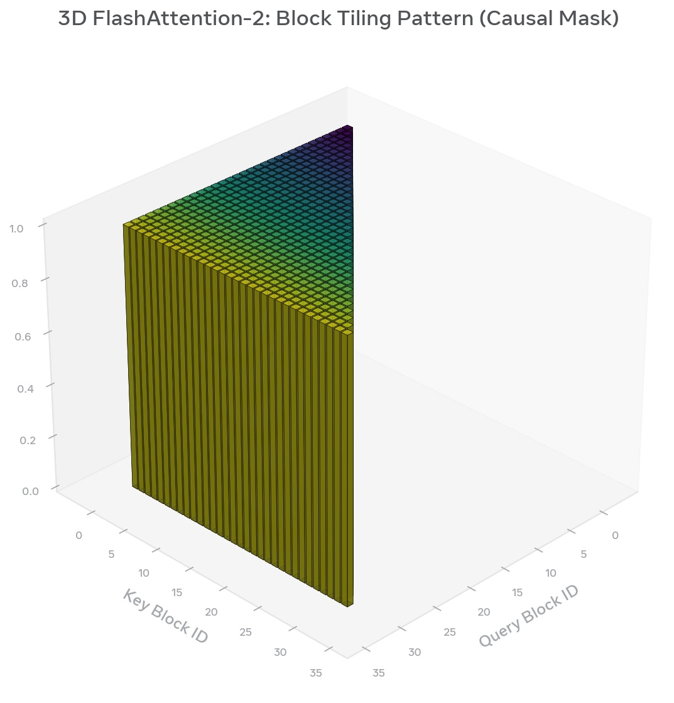 | 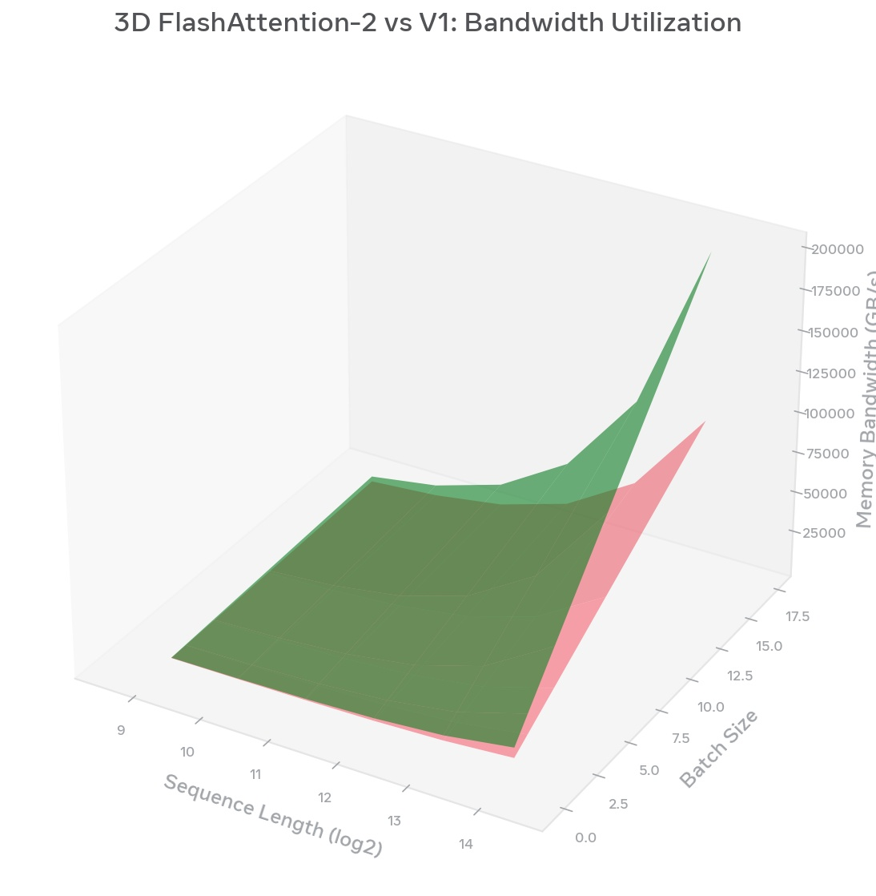 |

**Long-context attention**

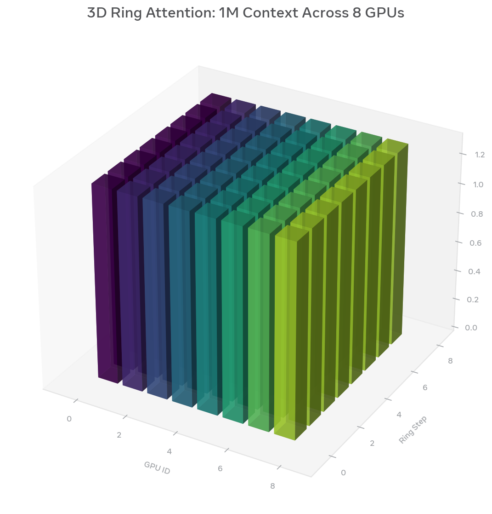

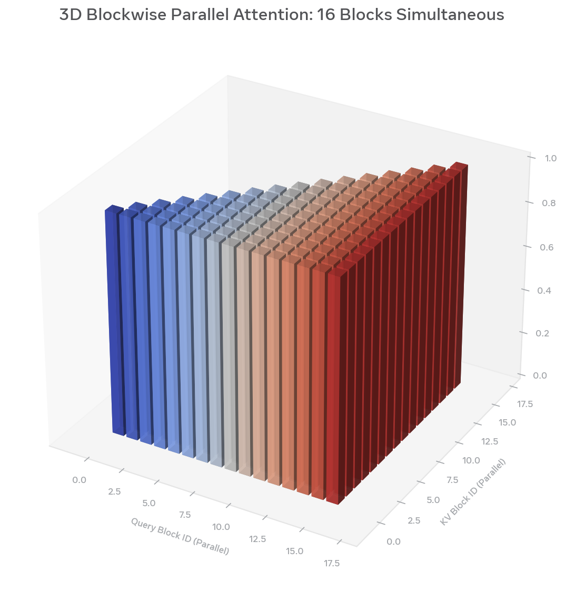

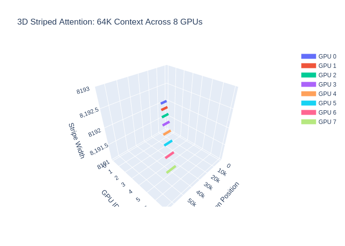

## 3. Distributed Training

| FSDP AllGather Pattern | FSDP vs DDP Memory Scaling |
|---|---|
| 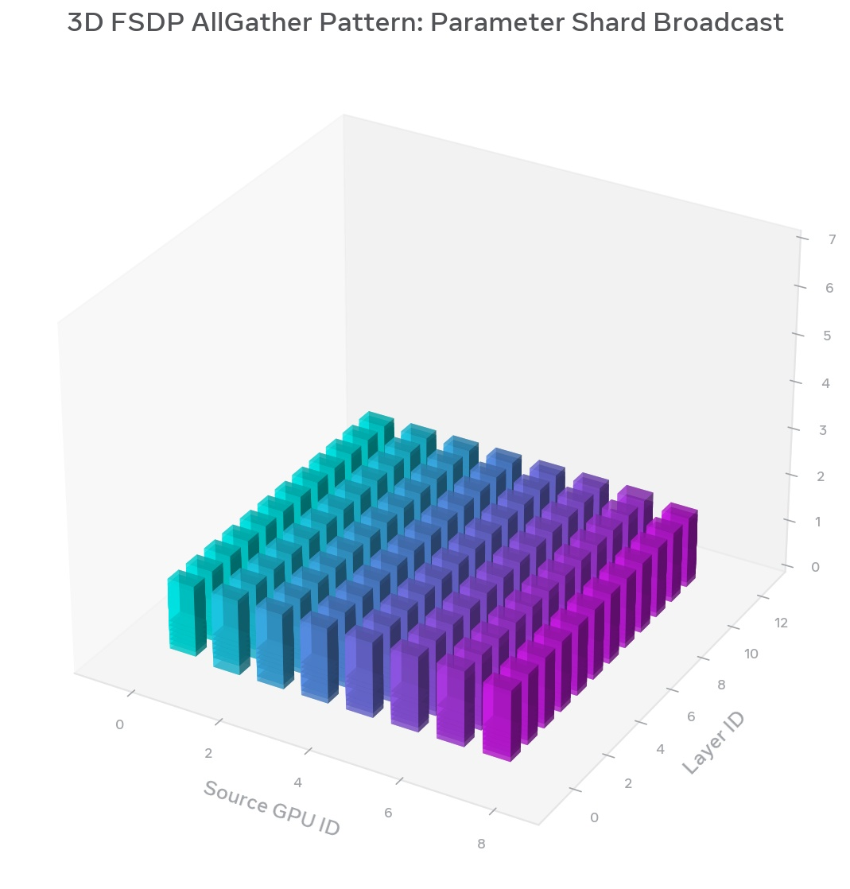 | 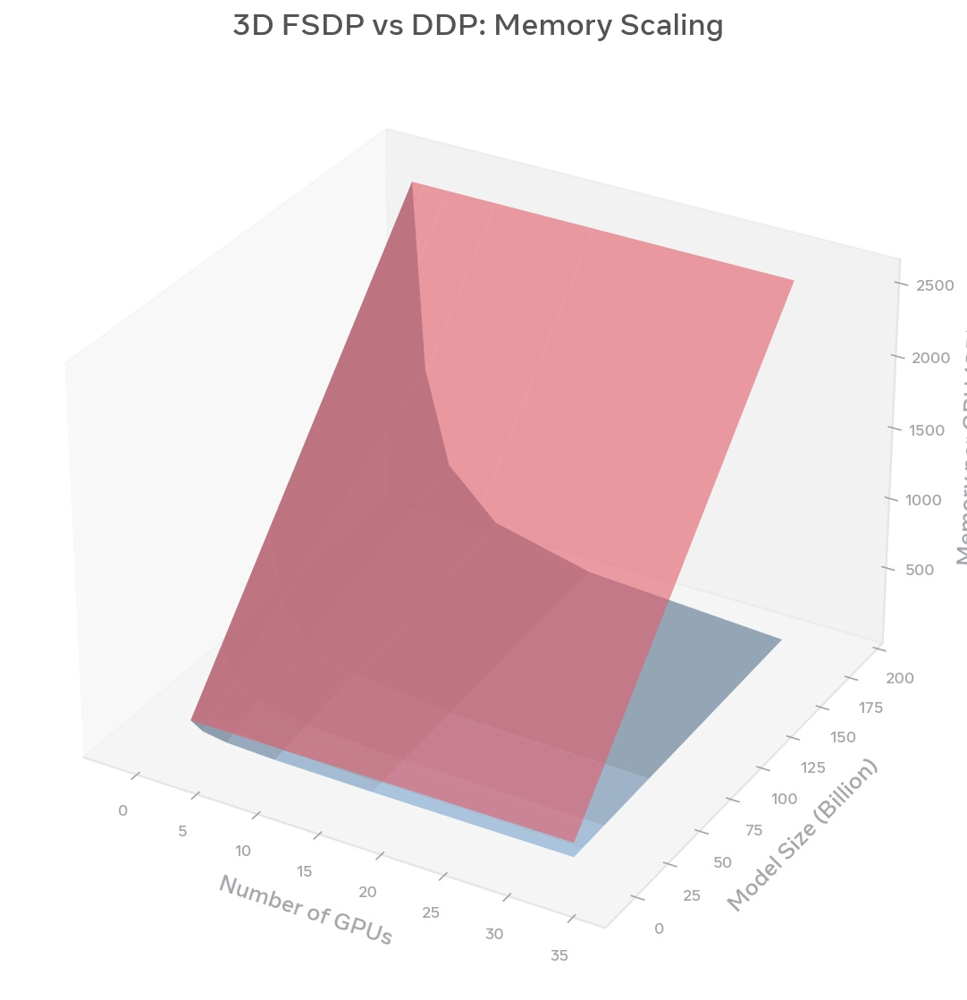 |

## 4. Mixture-of-Experts

| MoE 1T Params Token Routing | MegaBlocks Load Balancing |
|---|---|
| 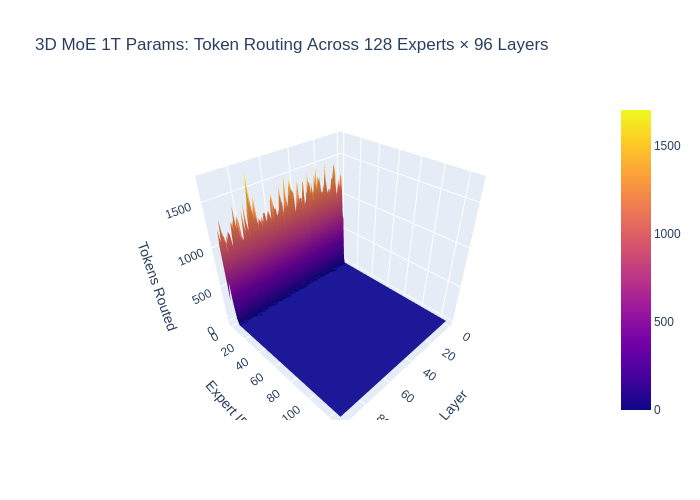 | 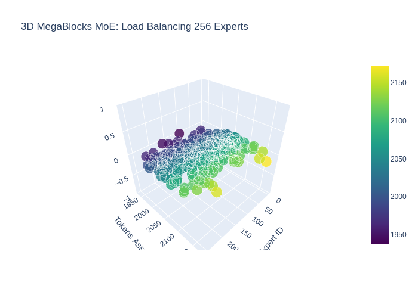 |

## 5. Inference & Serving

| Paged vLLM KV Cache | FlashDecoding Throughput |
|---|---|
| 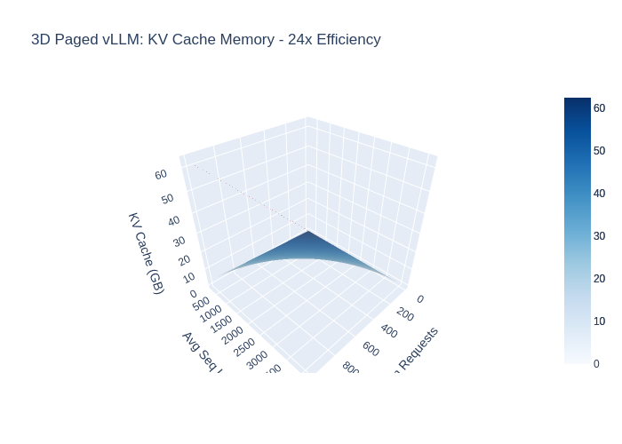 | 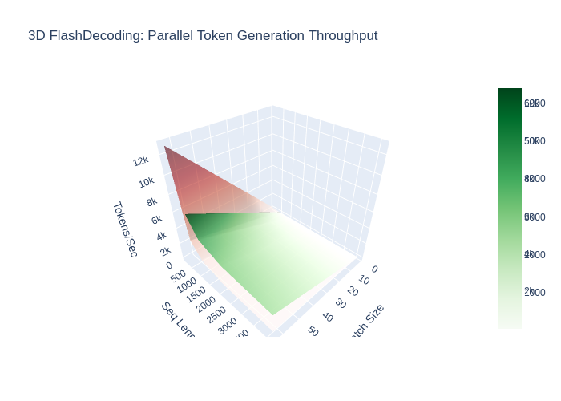 |

---

## Notebook

`Ultimate_LLM_Stack_All_Features.ipynb` generates additional interactive 3D plots with Plotly / Matplotlib:

- DeepSpeed ZeRO-3 vs FSDP memory
- Megatron-LM pipeline bubble
- QLoRA memory savings
- vLLM PagedAttention KV cache
- TensorRT-LLM vs vLLM throughput (assumed factor)
- Gradient flow: DPO vs PPO
- MT-Bench style score surface (example values)
- Example Ray Serve config for vLLM

No GPU is required, the notebook only needs NumPy, Matplotlib, Plotly and Pandas.

## Quick Start

```bash
git clone https://github.com/hskhalsa1990/llm-training-inference-3d-atlas.git
cd llm-training-inference-3d-atlas
pip install -r requirements.txt
jupyter notebook Ultimate_LLM_Stack_All_Features.ipynb
```

## Repository Layout

Flat layout, everything is in the repository root: `README.md`, `requirements.txt`, `.gitignore`, the notebook, and 15 diagram images (`3d_*.jpg` / `3d_*.png`).

## Author

Harpreet Singh — [@hskhalsa1990](https://github.com/hskhalsa1990)
